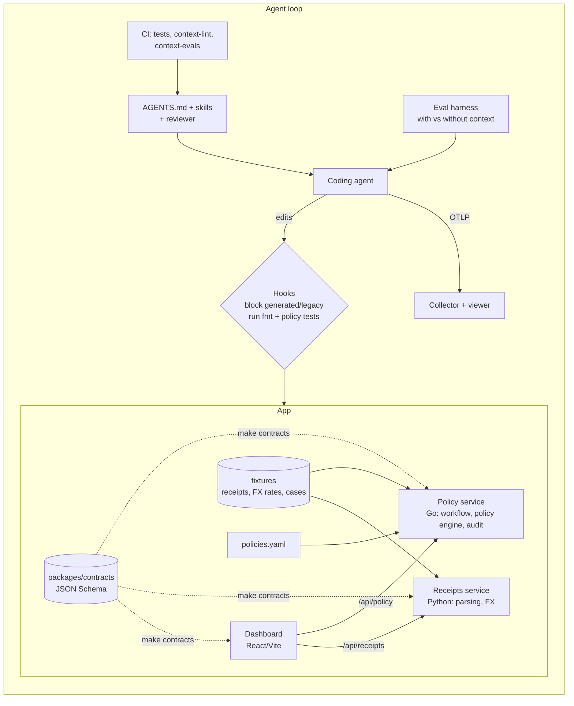

# agent-ready-expenses

A small, realistic expense tracker (**Tally**) used as a test bed for one question: *does investing in agent context (instruction files, skills, hooks, a reviewer) make coding agents measurably more dependable in a codebase?*

The repo is the app **and** the evidence:

1. **An agent-native monorepo**: layered, tool-neutral instruction files (`AGENTS.md` at the root and per service, `CLAUDE.md` and Cursor rules that only point to them).
2. **Prompt playbooks as code**: skills, slash commands and a read-only reviewer subagent in `.claude/`.
3. **Guardrails**: hooks that verify work during the session, plus CI.
4. **Evals**: a harness that runs the same ten tasks *with* and *without* the context and reports the difference.
5. **CI for context**: changing an instruction file or skill reruns the affected evals.
6. **Telemetry**: OpenTelemetry export of agent sessions to a local collector and viewer.
7. **Sandbox (stretch)**: a devcontainer whose only network path is an egress proxy that holds the secrets.

## Why an expense tracker

Approval policies, currency conversion and reporting are **precise business rules**, so the expected answer is unambiguous and graders can be mechanical (hidden tests, golden files, boundary cases). They also show whether context taught the agent the house rules: decimal money, policy-as-data, immutability, the audit trail. An agent can pass the tests and still use a float for money, put an `if` in a handler, or edit a submitted record; the harness records those separately as **rule violations**.

## Architecture



Money is `{amount_minor: integer, currency}` everywhere; policies are data in `services/policy/policies/policies.yaml`; submitted expenses are immutable and corrections are revisions; every transition writes an append-only audit entry. Details: `docs/SPEC.md`, `docs/architecture.md`, `docs/decisions/`.

## Results: with vs without context

<!-- results:start -->
Results pending: run `python3 evals/run_evals.py` and `python3 evals/report.py --readme README.md evals/results/<run>.jsonl`.
<!-- results:end -->

## Run it

```bash
make test            # Go, Python, TypeScript tests (no network)
make lint
make contracts       # regenerate typed models from packages/contracts
make e2e             # start both services, run submit -> approve -> reimburse -> report
python3 evals/run_evals.py --dry-run          # every task: setup fails, reference passes
python3 evals/run_evals.py --tasks tag:policy --trials 3
python3 evals/report.py evals/results/*.jsonl
python3 sandbox/demo_injection.py             # prompt-injection containment demo
```

Dashboard: `cd apps/dashboard && npm ci && npm run dev` with the two services running (`cd services/policy && go run ./cmd/policy`, `cd services/receipts && uvicorn app.main:app --port 8082`).

## Mapping to agent-enablement responsibilities

| Responsibility | Where |
|---|---|
| Make agents work in a real codebase | Layered `AGENTS.md`, progressive disclosure, explicit landmines |
| Reusable playbooks | `.claude/skills/*`, `.claude/commands/*`, `.claude/agents/reviewer.md`, `docs/playbooks/` |
| Guardrails | `.claude/settings.json` hooks (`scripts/hooks/`), CI, generator that rejects float money |
| Measure whether it works | `evals/` (hidden tests, golden files, rule-violation graders) |
| Keep context from rotting | `scripts/context_lint.py`, `context-evals.yml` |
| Observe agent behavior | `observability/` (OTLP collector, viewer, derived metrics) |
| Contain untrusted input | `sandbox/` (egress allowlist, secret swap, request log) |

## Lessons learned

See the end of this file once results are in.
