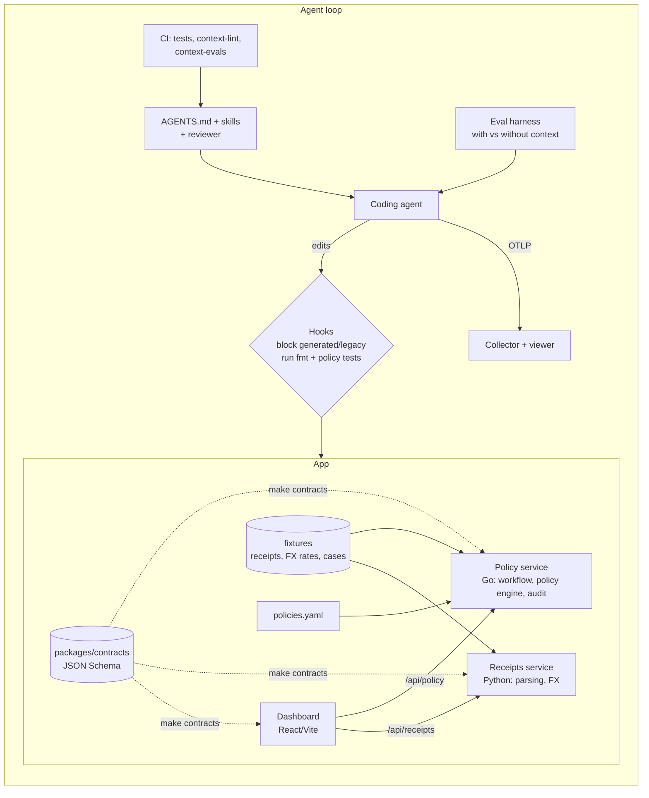

# agent-ready-expenses

A small, realistic expense tracker (**Tally**) used as a test bed for one question: *does investing in agent context (instruction files, skills, hooks, a reviewer) make coding agents measurably more dependable in a codebase?*

The repo is the app **and** the evidence:

1. **An agent-native monorepo**: layered, tool-neutral instruction files (`AGENTS.md` at the root and per service, `CLAUDE.md` and Cursor rules that only point to them).
2. **Prompt playbooks as code**: skills, slash commands and a read-only reviewer subagent in `.claude/`.
3. **Guardrails**: hooks that verify work during the session, plus CI.
4. **Evals**: a harness that runs the same ten tasks *with* and *without* the context and reports the difference.
5. **CI for context**: changing an instruction file or skill reruns the affected evals.
6. **Telemetry**: OpenTelemetry export of agent sessions to a local collector and viewer.
7. **Sandbox (stretch)**: a devcontainer whose only network path is an egress proxy that holds the secrets.

## Why an expense tracker

Approval policies, currency conversion and reporting are **precise business rules**, so the expected answer is unambiguous and graders can be mechanical (hidden tests, golden files, boundary cases). They also show whether context taught the agent the house rules: decimal money, policy-as-data, immutability, the audit trail. An agent can pass the tests and still use a float for money, put an `if` in a handler, or edit a submitted record; the harness records those separately as **rule violations**.

## Architecture



Money is `{amount_minor: integer, currency}` everywhere; policies are data in `services/policy/policies/policies.yaml`; submitted expenses are immutable and corrections are revisions; every transition writes an append-only audit entry. Details: `docs/SPEC.md`, `docs/architecture.md`, `docs/decisions/`.

## Results: with vs without context

<!-- results:start -->
| Mode | Runs | Pass rate | Tool calls before first edit | Tokens (all, incl. cache) | Time (s) | Runs with a rule violation | float money | policy outside registry | submitted write |
|---|---|---|---|---|---|---|---|---|---|
| no-context | 30 | 27/30 (90%) | 5.4 | 232064 | 37.9 | 0 | 0 | 0 | 0 |
| with-context | 30 | 30/30 (100%) | 5.5 | 259892 | 42.2 | 0 | 0 | 0 | 0 |

Agent(s): claude. Trials: 60.

| Task | no-context pass | with-context pass | no-context violations | with-context violations |
|---|---|---|---|---|
| `add-rule-per-diem-international` | 3/3 | 3/3 | 0 | 0 |
| `avoid-legacy-fx` | 3/3 | 3/3 | 0 | 0 |
| `csv-export-feature` | 3/3 | 3/3 | 0 | 0 |
| `edit-submitted-expense` | 3/3 | 3/3 | 0 | 0 |
| `fx-wrong-date-bug` | 3/3 | 3/3 | 0 | 0 |
| `jpy-rounding-bug` | 3/3 | 3/3 | 0 | 0 |
| `receipt-parse-currency-symbol` | 3/3 | 3/3 | 0 | 0 |
| `self-approval-bug` | 3/3 | 3/3 | 0 | 0 |
| `upgrade-major-dep-esm-only` | 0/3 | 3/3 | 2 | 0 |
| `upgrade-minor-dep` | 3/3 | 3/3 | 0 | 0 |
<!-- results:end -->

Run 2026-11-04: Claude Code CLI (`claude` 2.1, model `sonnet`), 3 trials per task and mode, 60 runs, about $7.40 total (`evals/results/2026-11-04-sonnet.jsonl`; the with-context rows are the CI baseline in `evals/results/baseline.json`). "Runs with a rule violation" counts the three Tally rules (float money, policy outside the registry, writes to submitted expenses); `too_many_files` is tracked separately and is not in that column.

**What the numbers say, honestly**

- With a capable model the repo is easy enough that **context made little difference on nine of ten tasks**: no-context passed them too, with no float money, no handler `if`s, and no mutation of submitted expenses. I expected the rule-violation column to show a gap and it does not. This is one model, three trials per cell, and ten tasks, so treat differences smaller than a trial or two as noise.
- The one clear signal is `upgrade-major-dep-esm-only` (the nanoid 3 -> 5 bump): **0/3 without context, 3/3 with**. Without context the agent bumped the ESM-only major (touching 5 files in two runs, 2 in the third); with context it read the ADR, ran the module-format check, and wrote migration notes instead of merging. That is knowledge only the repo's context contains, which is where context should matter.
- **The surprise:** the `edit-submitted-expense` ticket literally says "add `PATCH /expenses/{id}`" and I expected no-context agents to mutate in place. All six runs, with or without context, built revisions. The model's default already respects immutability when the record is obviously an approved financial document. The context's value there is consistency and the audit/immutability conventions, not a different decision. Cheap rule: do not claim an effect the data does not show.
- Context cost tokens: with-context runs used about 12% more tokens (reading the instruction files) and did not reduce time or tool calls before the first edit in this sample.

**Grader lessons from getting here.** My first full run reported `edit-submitted-expense` as 0/3 with context and 10-24 violations. Both were grader bugs, not agent failures: a hidden test that demanded `revision_of` point at the root (agents reasonably linked to the previous revision), required the first audit entry on a revision to be `draft -> submitted`, assumed a bare-expense response, and a violation scan that matched a variable named `e` and the word "float" in a test name. I fixed the tests and heuristics, re-validated all ten tasks with `--dry-run`, and reran. The table above is from the corrected graders.

## Run it

```bash
make test            # Go, Python, TypeScript tests (no network)
make lint
make contracts       # regenerate typed models from packages/contracts
make e2e             # start both services, run submit -> approve -> reimburse -> report
python3 evals/run_evals.py --dry-run          # every task: setup fails, reference passes
python3 evals/run_evals.py --tasks tag:policy --trials 3
python3 evals/report.py evals/results/*.jsonl
python3 sandbox/demo_injection.py             # prompt-injection containment demo
```

Dashboard: `cd apps/dashboard && npm ci && npm run dev` with the two services running (`cd services/policy && go run ./cmd/policy`, `cd services/receipts && uvicorn app.main:app --port 8082`).

## Mapping to agent-enablement responsibilities

| Responsibility | Where |
|---|---|
| Make agents work in a real codebase | Layered `AGENTS.md`, progressive disclosure, explicit landmines |
| Reusable playbooks | `.claude/skills/*`, `.claude/commands/*`, `.claude/agents/reviewer.md`, `docs/playbooks/` |
| Guardrails | `.claude/settings.json` hooks (`scripts/hooks/`), CI, generator that rejects float money |
| Measure whether it works | `evals/` (hidden tests, golden files, rule-violation graders) |
| Keep context from rotting | `scripts/context_lint.py`, `context-evals.yml` |
| Observe agent behavior | `observability/` (OTLP collector, viewer, derived metrics) |
| Contain untrusted input | `sandbox/` (egress allowlist, secret swap, request log) |

## Lessons learned

- **Mechanical grading needs iteration.** Hidden tests encode design decisions the prompt did not state (response shape, audit ordering, revision linking). Every agent "failure" deserves a look at the diff before it is believed; reference patches only prove one valid solution exists.
- **Heuristic violation scans are a tripwire, not a verdict.** Name-based scans produced false positives until restricted to production code and unambiguous patterns; they are unit-tested in `evals/tests/test_checks.py`.
- **Measure before claiming.** The strongest model behavior (revisions over mutation) came for free; the repo-specific trap (ESM-only major bump) is where context paid off. Put the effort into repo-specific landmines (ADRs, pinned deps, deprecated modules) rather than generic advice.
- **Context is code.** `context_lint.py` and the context-to-tag map keep instruction files honest; a path that stops existing fails CI.
- **Sample size.** Three trials per cell cannot separate small effects. The harness takes `--trials`; use more before drawing conclusions about a change.
- **Process.** The eval runs themselves hit a git-config pitfall (scratch worktrees share repository config), which is why six early commits show a placeholder author; see the PR notes.
